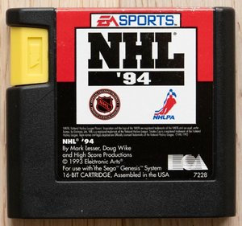
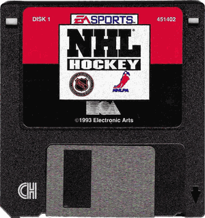

# NHL '94 PC compared with the 93 and 94 console games

People often say NHL '94 PC (EA's DOS "NHL Hockey", 1993) is really NHLPA 93 because it has no Anaheim or Florida.
This page checks the game code instead. Each row compares a gameplay feature in this repo's disassembly
of `HOCKEY.EXE` and its overlays with the NHLPA 93 and NHL 94 console disassemblies:

- 93 consoles: [NHLPA93Genesis](https://github.com/abdulahmad/NHLPA93Genesis) and [NHLPA93SNES](https://github.com/abdulahmad/NHLPA93SNES)
- 94 consoles: [NHL94Genesis](https://github.com/abdulahmad/NHL94Genesis) and [NHL94SNES](https://github.com/abdulahmad/NHL94SNES)

Addresses are `segment:offset` from the routine headers in this repo. The labels are the repo's current names.

Confidence levels:

- **Code**: the routine or table was read and compared.
- **Data**: a string or table shows it, but the logic wasn't traced.
- **Not found**: searched for and absent. That is strong evidence but not proof.

## Feature table

| Feature | 93 consoles | 94 consoles | 94 PC | Evidence | Confidence |
|---|---|---|---|---|---|
| **Fighting** | Yes. `checkfight` starts fights; `assfight` / `assfwatch` assignments; Fighting, Fighting * and Fight Instigator penalties (93G `hockey93.asm`, `tables93.asm`) | Removed. 94G keeps `checkfight` as a bare `rts` (`collide94.asm`); the fight frames are left over and unused | **Removed (94-like).** The collision routine `checkcx` (28BB:319A) calls `newcheck`, `checkint`, `checkcheck` and nothing else, so even the `checkfight` call is gone. `asstab` has no fight assignments; the slots after `asspassrec` hold `assstarskate` / `assthreestars`. The SPA table (`SPAlist`) has no fight animation. The penalty name list has no fighting penalty | Code |
| **Fighting rating on the player card** | Shown: `[ Fighting ]` column (93G `tables93.asm` PAttribColumns, 93S `PAttribColumns.asm`) | Gone from the card; the list ends at Checking (94G `tables94.asm`, 94S `PAttribColumns.asm`) | **Gone (94-like).** The skater ratings list is Speed, Agility, Weight, Shot Power, Checking, StickHandling, Accuracy, Passing, Off./Def. Awareness, Aggressiveness, Endurance, then Shoot/Pass Bias and Faceoffs. No Fighting. (Shoot/Pass Bias isn't new: the 93 and 94 console player records already carry a shot/pass decision value, they just don't show it on the card; see Teams and rosters.) (`dgroup.asm`, `str_Speed_2` onward) | Data |
| **One-timers** | None: no one-timer code or animation in either 93 disassembly | New in 94: 94G `onetimer94.asm`; 94S `asspassrec` / `assbreakaway` with `SPAonetimerf` / `SPAonetimerb` | **Yes (94-like).** `assonetimer` (2C24:0746) plays `SPAonetimef` / `SPAonetimeb` as the pass arrives. `asspassrec` (2C24:0A1C) calls it when `onetimerflag` is set. `OneTimerChk` (2C24:096C) lets the CPU team set up one-timers too | Code |
| **Which 94 one-timer it resembles** | n/a | 94G: aimed pass to a target spot (`OneTimerPass`). 94S: the receiver swings, with forehand / backhand picked by `Findhittype` | **The 94 SNES design.** `assonetimer` follows the same steps as 94S `asspassrec`. If the player is already in the one-timer animation it releases the shot. Otherwise it builds the vector to the goal, calls `Findhittype` and sets the backhand or forehand one-timer animation | Code |
| **Goalie wall animations** | Not in either 93 game (no `SPAgwall*`) | 94 SNES only: `asseben` / `assbench` give a goalie `SPAgwallright` / `SPAgwallleft` where skaters get `SPAwallright` / `SPAwallleft` | **Yes, as in 94 SNES.** `asseben` (2519:0A62) does `cmp [si+0x1a],1 / sbb / and 0x574 / add SPAno(SPAwallright)`, so a goalie (position 0) gets SPA number +0x574. Counting the SPA table shows that +0x574 from `SPAwallright` is exactly `SPAgwallright` (and +0x56E from `SPAwallleft` is `SPAgwallleft`) | Code |
| **Board checks, bench check, cross-check animation** | No: `FallDown` picks from `SPAfallfwd`, `SPAfallback`, `SPAflip`, `SPAstumble`, `SPAinjury1` | Yes: 94G `FallDown` adds `SPAboardfront/back/left/right`, `SPAbenchcheckl/r`, `SPAcrosscheck`, `SPAinjuryfall` (94S has the same family) | **No (93-like).** `FallDown` (28BB:1848) uses only `SPAfallfwd`, `SPAfallback`, `SPAflip`, `SPAstumble`, `SPAinjury1` (plus `SPAreffallback` for the referee). None of the board, bench or cross-check animations exist in `SPAlist`. `checkcheck` (28BB:0284) uses `SPAsweepchk`, `SPAHold`, `SPAhook`, `SPAburst` and the `CheckAnims` table | Code |
| **Penalty shots** | None | Yes: `PenShotChk` turns a penalty on a breakaway into a penalty shot; there are penalty-shot forms of the penalties (`PenDatachargeps` etc.) and `BA_PS_flags` | **Not found (93-like).** `checkcheck` calls `AddPenalty` directly with no breakaway or penalty-shot check. The penalty names have no duplicate penalty-shot forms. There is no penalty-shot assignment in `asstab`. Note: routines labelled `PenShotStart` / `PenShotAssign` (2164:00E0 / 2164:0152) were named by their position in 95 PC. The code sends skaters to `asstakeposition` / `assleavebox` / `assbenchwait` after the referee's whistle and doesn't look like a penalty shot, so those labels need review | Code (absence) |
| **Shootout mode** | None | Yes: 94G `shootout94.asm`, `shootoutpath94.asm`; 94S the same | **Not found (93-like).** No shootout strings or code. The `clockcont_0` header comment mentions "shootout", but no shootout code was found to back it up, so that comment needs review | Data (absence) |
| **In-game team stats** | 8 rows: Score, Shots, Power Play, Penalties, Faceoffs Won, Body Checks, Attack Zone, Passing (93G `stats93.asm` TeamStatTextTbl) | 16 rows: adds Shooting Pct, PP Minutes, PP Shots, SH Goals, Breakaways, One-Timers, Penalty Shots, Passing Pct (94G `period94.asm`, 94S `TeamStatNames.asm`) | **The 93 list, in the same order (93-like):** Score, Shots, Power play, Penalties, Faceoffs won, Body checks, Attack zone, Passing (`data/far/stat_names.asm`). The PC league stats screens (PP / SH goal leaders etc.) are separate and PC-only | Data |
| **Players per game** | 2 | 94G: up to 4 with 4 Way Play (`fourway94.asm`). 94S: up to 5 with the MultiPlayer 5 multitap. `PlayerSelect` clears and places five pads (`cont1team`-`cont5team`, `ram94s.asm`), and `Multi5Init` / `Multi5ConnectCheck` detect the adaptor. The boxes say 1-4 (94G) and 1-5 (94S, "Hudson Soft Super Multitap") | **2 (not 94-like).** Only `cont1team` / `cont2team` exist; `SetupControllers` (1F9C:0000) sets up two players. The box says "play one or two players head to head" | Code |
| **Manual goalie toggle** | No pause-menu goalie mode | 94G pause item "Manual Goalie / Auto Goalie" (`period94.asm` ManualGoalieMenu) | **Not found.** The PC menus have Home / Visiting Team Goalie, but that picks which goalie starts. The PC also has PULL GOALIE / RETURN GOALIE, like both consoles | Data |
| **Hot / cold streaks and scouting text** | 93G and 93S have a pregame scouting report (93G `ScoutingReport`, `hockey93.asm`), as NHL Hockey (92) Genesis already did (`ScoutingReport`, `hockey.asm`; its box lists "scouting reports"); no hot / cold | 94G hot / cold tables (`Create_HotCold_Table`, `HotColdIcon`) feed the ratings | **Not found** | Data (absence) |
| **Organ music** | Eight songs in all ($30-$37: goal, period start, power play, faceoff, title and so on); no per-team organ tunes and no organ credit | Per-team organ tunes (94G `arena94.asm` `TeamSongs`), credited "Organ Music by Dieter Ruehle" | **The 94 per-team organ set**, loaded from `.KMS` files (`LoadArenaJingles` 2137:0004, `PlayArenaJingle`), credited "Organ Music" / Dieter Ruehle. 50 of its 53 tunes match 94 SNES note for note; see Music and packaging | Code |
| **Line changes, energy, injuries, instant replay, pulling the goalie, playoffs** | Yes | Yes | Yes | Present in all of them, so they don't separate 93 from 94 | Data |
| **Referee on the ice** | No referee animations | No referee animations | **PC-only:** `SPArefglide` ... `SPArefbehind` with penalty signals, and the `assref*` assignments | Code |
| **Anthem, Stanley Cup presentation, three stars skate** | `SPAstanley` celebration only | `SPAstanley` only | **PC-only:** `SPAanthem1-5`, `SPAgetcup`, `SPAbrcup`, `SPAgvcup`, `SPAstansk`, `assstarskate`, `assthreestars` | Code |
| **Other PC-only gameplay bits** | | | Faceoff poke (`SPAfaceoffpoke`), Abuse of Official and Checking from Behind penalties, a Faceoffs rating, Shoot/Pass Bias shown on the card, league / season mode with leader boards, mouse / joystick setup | Data |

## What the box says

Abdul transcribed the back of every EA NHL box from 92 to 96. The 94 PC claims are checked against the code here.
Box text is marketing, so it is quoted as "the box says". Where the box and the code disagree, the code wins.

| The box says (94 PC floppy) | Code | Confidence |
|---|---|---|
| "create a league of your own with up to 24 human participants" | **Matches.** New League asks for the human-controlled teams (`str_SelectHumanControlledTeams`, `LeagueTeamSelect` in `front/new_league.asm`), and the only refusal when adding one is "All the teams are already human" (`front/league_teams.asm`). So any of the 24 teams can be human. Each human team has a password (`AskTeamPassword`), and there is a league master password (`CheckMasterPassword`) | Data; Inferred (no limit below 24 was found) |
| "team and player stats in over 15 categories" | **Matches: 16 leader-board sorts plus standings.** Teams have 5 (Scoring, Defense, Penalty Killing, Power Play, Penalties), players 8 (Points, Goals, Assists, Power Play Goals, Shorthanded Goals, Plus/Minus, Penalty Minutes, Shooting Percentage) and goalies 3 (Goals Against Average, Wins, Save Percentage) (`data/far/menu_text.asm`) | Data |
| "end-of-season awards including Hart, Norris and Ross" | **Matches.** 94 PC has the 10-award list (see the NHL95PC page). No 94 console has season awards, and the 95G and 95S boxes call season mode and its awards "all new in 95". So 94 PC had a season with awards a year before the consoles | Data |
| "instant replay that saves highlights to a personal highlight reel" | **Matches.** `ReplaySaveHilight` writes highlights to disk ("Insufficient disk space to save hilights.", `data/far/hilight_save_messages.asm`), and the menus have "League Hilights ...", "Play-Off Hilights ..." and "Select a hilight". Instant replay itself is in every game back to NHL Hockey (92) Genesis, whose box lists it too | Data |
| "simulate the actual 1993 NHL season" (and an 84-game schedule, implied) | **Consistent.** The trade deadline check in `TradePlayers` (`front/trade.asm`) closes trading from March 20 (month 3, day 0x14), in months 4-9, or once 1008 games have been played. 1008 is 24 teams x 84 games / 2, so the full schedule is the 84-game 1992-93 season | Code (the check); Inferred (84 games) |
| "over 70 pieces of digitized organ music" | **Partly.** The game ships 71 `.KMS` songs, but only 53 of them are team organ tunes. The rest are menu and event songs. They are sequenced songs in EA's song format, not digitized recordings. 95 PC is the first PC game with digitized `.IFF` music (see the NHL95PC page). The 94G and 94S boxes also say "over 70". 94G has 72 organ songs, 70 of which its tables can play. 94S has 53, because it merges key and tempo variants (see Music and packaging) | Data |
| "one-timers (drop a set pass to your big stick at the point)" | **Matches** the one-timer rows above. "Drop a set pass" here means the pass that sets up the one-timer, not a drop-pass move: 94 PC has **no drop pass at all**. `dopass` (`engine/physics.asm`, 28BB:0B96) always either passes to the closest teammate within one 45° step of `passdir`, straight ahead preferred (`passtoa0`), or, with nobody there, sends the puck along `passdir` at the pass speed plus the passer's velocity. No branch leaves the puck behind. 95 PC adds one (`PassLaneChk` / `ScatterPass`, see the NHL95PC page); 95G's is a separate button move | Code |
| "play one or two players head to head" | **Matches** (Players per game row) | Code |

The other 94 boxes, compared with the code:

- **94 Genesis "Battery back-up (records for you and 6 friends)":** yes. `sram94.asm` validates and reads the save RAM
  (`ValidSRAM`), and `cards94.asm` `UpdateRecords` keeps the user records unless they're turned off (`OptUserRec`). The
  Sega CD keeps the same records in its backup RAM (see NHL94Genesis `docs/segacd_differences.md`). **94 SNES** has
  no battery: its header gives an SRAM size of none (`header/snes_header.asm`), and its box doesn't claim one. 94 PC
  saves league stats and highlights to disk instead. (Code / Data)
- **94 SNES "5-player support":** yes, see Players per game. (Code)

## Teams and rosters

The PC teams and players come from the game's data files: `TEAMS.DB` (26 records of 744 bytes: abbreviation, full name,
city, then 28 roster slots that point into `KEY.DB`), `KEY.DB` (710 player records of 52 bytes: jersey, position, first
and last name, pointers to ratings and stats) and `ATT.DB` (20 ratings per player, each 0-15). The console columns come
from the console team data (`teamdata93.asm` / `teamdata94.asm` and the SNES equivalents) with the player names.

| | 93 consoles | 94 consoles | 94 PC | Confidence |
|---|---|---|---|---|
| **Teams** | 24 + All Stars East / West | 26 (adds Anaheim, Florida; Minnesota becomes Dallas) + All Stars East / West | **24** + Campbell All Stars / Wales All Stars. Minnesota North Stars (shown as "Minnesota Stars"), no Dallas, Anaheim or Florida | Data |
| **Team names** | City and abbreviation only, no nicknames ("New York", "Long Island", "Minnesota"): the NHLPA-only licence | City, nickname and arena ("Boston Bruins"); team logos marked "New in 94" (`logos94.asm`) | **Full NHL names** ("Boston Bruins"), per-team crests, jerseys and logos (`EMB*.QPP`, `JER*H/V.QPP`, `CRESTS*.BIN`), i.e. NHL-licensed like 94 | Data |
| **Conference / All-Star names** | East / West | East / West | Campbell / Wales (the 1992-93 conference names) | Data |
| **Players per team** | 22-25 (Ottawa 17, Tampa Bay 18); 601 in all | 94G 25 (Washington 24, Florida 17, Anaheim 18), 684 in all; 94S 22-25, 653 in all | **26-28** of 28 slots, 3 goalies each; 659 different players on the 24 teams; the All-Star teams have 25 each | Data |
| **Roster season** | About 1991-92 (no Lindros, Selanne, Potvin, Zamuner) | The 1992-93 rosters, plus Dallas and the June 1993 expansion draft for Anaheim and Florida | **End of 1992-93**: deadline trades in, All-Star teams match the February 1993 game | Data |
| **Same player on the same team as PC** | 353 of 660 PC roster spots (53%) | 94G 561 (85%), 94S 537 (81%) | (reference) | Data |
| **1993-94 rookies** (Daigle, Pronger, Arnott, Brodeur, Renberg, Niedermayer, Yashin) | Absent | Absent | Absent | Data |

Where some well-known players are (PC / 93 Genesis / 94 Genesis / 94 SNES):

| Player | 94 PC | 93 Genesis | 94 Genesis | 94 SNES |
|---|---|---|---|---|
| Grant Fuhr | BUF | TOR | BUF | BUF |
| Paul Coffey | DET | LA | DET | DET |
| Dominik Hasek | BUF | CHI | BUF | BUF |
| Ron Hextall, Steve Duchesne | QUE | PHI | QUE | QUE |
| Bob Kudelski | OTT | LA | OTT | OTT |
| Eric Lindros, Teemu Selanne, Felix Potvin, Rob Zamuner | PHI, WPG, TOR, TB | not in the game | same as PC | same as PC |
| Mike Modano, Jon Casey | MIN | MIN | DAL | DAL |
| Scott Mellanby | EDM | EDM | EDM and FLA | FLA |
| Brian Skrudland | CGY | MTL | CGY and FLA | FLA |
| Guy Hebert | STL | STL | STL and ANH | ANH |

The PC All-Star teams carry the 1993 game's one-time picks (Campbell: Gretzky, Kisio, Falloon, Bradley; Wales: Marsh,
Sidorkiewicz, Zalapski, Duchesne), which is how the roster date was pinned. 94 Genesis lists some expansion-draft players
twice, on the old team and the new one (the "and" rows above). (Data)

**Ratings.** All three generations store the same 16 four-bit values per player: jersey (two digits), weight, agility
(leg power), speed, offensive and defensive awareness, shot power, checking, handedness, stickhandling, shot accuracy,
endurance, shot/pass decision, passing and aggressiveness (Data). The ranges differ: 93 Genesis uses 0-15, 94 Genesis
mostly 0-6, and PC `ATT.DB` uses 0-15 like 93 (Data). Example, Ray Bourque: 93 Genesis `778FCCCFF1F6F3F5`, 94 Genesis
`77A5446560556252`, PC `ATT.DB` `01 0a 0d 08 0e 0f 0e 0d 0e 0e 0a 0f 05 0f 04 01 0a 0a 0a 07`. The PC field order is
mapped in the next table.

**PC `ATT.DB` field order.** Each player has a 20-byte record; `KEY.DB` holds its offset (first of the three dwords at
bytes 36-47; several players can share a record, which is why the file has fewer records than `KEY.DB`). The order comes
from three places that agree: the player-card column tables in `dgroup.asm` (`SkaterCardCols` = 1, 2, 3, 4, 5, 6, 7, 9,
10, 11, 12, 13, 14, 0x13 against the Speed ... Faceoffs labels; `GoalieCardCols` = 1-8, 10, 11 against Glove Left ...
Defensive Awareness), the order `setplayer` (`src/engine/hockey.asm`) copies the bytes into the player struct, and a
correlation of each byte against the 94 Genesis ratings of the same players (521 skaters, 49 goalies).

| Byte | Skaters (card label) | Goalies (card label) | Console nibble it matches (94 Genesis correlation) | Confidence |
|---|---|---|---|---|
| 0 | Shoots L / R (0 = the other hand; sets the x-flip bit) | Glove hand | handedness (-0.80) | Code |
| 1 | Speed | Glove Left | speed (0.82); goalies: aggressiveness slot = 93G glove-left save (0.83) | Code |
| 2 | Agility | Glove Right | leg power (0.86); goalies: passing slot = glove-right save (0.89) | Code |
| 3 | Weight | Stick Left | weight (0.90); goalies: shot/pass slot = stick-left save (0.86) | Code |
| 4 | Shot Power | Stick Right | shot power (0.82); goalies: endurance slot = stick-right save (0.82) | Code |
| 5 | Checking | Puck Control | checking (0.90) | Code |
| 6 | StickHandling | Speed | stickhandling (0.89); goalies: speed (0.82) | Code |
| 7 | Accuracy | Agility | shot accuracy (0.88); goalies: leg power (0.88) | Code |
| 8 | not shown, not read by `setplayer` | Weight | skaters: none (0.67 with passing); goalies: weight (0.84) | Data |
| 9 | Passing | not shown | passing (0.90) | Code |
| 10 | Offensive Awareness | Offensive Awareness | offensive awareness (0.88; goalies 0.99) | Code |
| 11 | Defensive Awareness | Defensive Awareness | defensive awareness (0.90; goalies 0.94) | Code |
| 12 | Aggressiveness | not shown | aggressiveness (0.89) | Code |
| 13 | Endurance | not shown | endurance (0.85) | Code |
| 14 | Shoot/Pass Bias | not shown | shot/pass decision (0.90) | Code |
| 15-18 | not shown, not read by `setplayer` | not shown | none clearly (16-18 track offensive awareness, about 0.65) | Unknown |
| 19 | Faceoffs | not shown | none on consoles; centres average 10.3, wingers 5.7-5.8, defence 3.3 | Code (label), Data (values) |

So the PC keeps every console rating and adds Faceoffs (byte 19), and stores them in the order the card shows them,
not the console nibble order (jersey, weight, agility, speed, awareness, shot power, checking, hand, stickhandling,
accuracy, endurance, shot/pass, passing, aggressiveness). The jersey number lives in `KEY.DB` instead. Skaters and
goalies reuse the same byte positions for different ratings, just as the console nibbles do. Bytes 8 (skaters) and
15-18 have no known use.

**Verdict:** PC rosters are the 1992-93 rosters the 94 consoles were built from, before expansion, under the full NHL
licence. They aren't the older NHLPA 93 rosters.

## All-Star teams

The All-Star rosters were compared player by player: the PC's two All-Star records in `TEAMS.DB` / `KEY.DB` against
the All Stars East / West records in the console team data. Console positions come from the line slots (G, D, or a
forward slot), the PC's from `KEY.DB`. Names were matched on last name and first initial (the console data abbreviates
some names). The real 1993 rosters are from the [44th NHL All-Star Game](https://en.wikipedia.org/wiki/44th_National_Hockey_League_All-Star_Game)
page (Montreal, February 6, 1993).

**93 Genesis = 93 SNES and 94 Genesis = 94 SNES.** The two 93 versions have the same All-Star players in the same order
with the same rating data (22/22 and 22/22 records identical), and so do the two 94 versions (25/25 and 25/25). (Data)

| | Players (G / D / F) | Same players as PC, East | Same players as PC, West | Both teams |
|---|---|---|---|---|
| 93 Genesis | East 22 (3 / 6 / 13), West 22 (3 / 7 / 12) | 11 / 25 | 9 / 25 | **20 / 50 (40%)** |
| 93 SNES | East 22 (3 / 6 / 13), West 22 (3 / 7 / 12) | 11 / 25 | 9 / 25 | **20 / 50 (40%)** |
| 94 Genesis | East 25 (3 / 8 / 14), West 25 (3 / 8 / 14) | 21 / 25 | 20 / 25 | **41 / 50 (82%)** |
| 94 SNES | East 25 (3 / 8 / 14), West 25 (3 / 8 / 14) | 21 / 25 | 20 / 25 | **41 / 50 (82%)** |
| 94 PC | Wales 25 (3 / 8 / 14), Campbell 25 (3 / 8 / 14) | | | |

Rosters (G; D; F):

- **94 PC, Wales:** G: Patrick Roy, Peter Sidorkiewicz, Craig Billington. D: Ray Bourque, Zarley Zalapski, Brad Marsh, Steve Duchesne, Scott Stevens, Brian Leetch, Kevin Lowe, Al Iafrate. F: Adam Oates, Pat LaFontaine, Alexander Mogilny, Kirk Muller, Joe Sakic, Pierre Turgeon, Mark Messier, Mike Gartner, Mark Recchi, Kevin Stevens, Mario Lemieux, Jaromir Jagr, Rick Tocchet, Peter Bondra.
- **94 PC, Campbell:** G: Mike Vernon, Ed Belfour, Jon Casey. D: Dave Manson, Randy Carlyle, Chris Chelios, Steve Chiasson, Paul Coffey, Jeff Brown, Garth Butcher, Phil Housley. F: Gary Roberts, Luc Robitaille, Wayne Gretzky, Jari Kurri, Kelly Kisio, Pat Falloon, Pavel Bure, Teemu Selanne, Jeremy Roenick, Steve Yzerman, Mike Modano, Brett Hull, Brian Bradley, Doug Gilmour.
- **93 Genesis / 93 SNES, All Stars East:** G: Patrick Roy, Mike Richter, Don Beaupre. D: Ray Bourque, Paul Coffey, Brian Leetch, Kevin Hatcher, Eric Desjardins, Scott Stevens. F: Mario Lemieux, Mark Messier, Rod Brindamour, Bryan Trottier, Joe Sakic, Ray Ferraro, John Cullen, Jaromir Jagr, Alexander Mogilny, Owen Nolan, Kevin Stevens, Randy Burridge, Kirk Muller.
- **93 Genesis / 93 SNES, All Stars West:** G: Ed Belfour, Kirk McLean, Tim Cheveldae. D: Al MacInnis, Chris Chelios, Doug Wilson, Phil Housley, Mark Tinordi, Larry Robinson, Dave Ellett. F: Wayne Gretzky, Jeremy Roenick, Adam Oates, Steve Yzerman, Sergei Fedorov, Brett Hull, Trevor Linden, Theoren Fleury, Luc Robitaille, Gary Roberts, Brian Bellows, Vincent Damphousse.
- **94 Genesis / 94 SNES, All Stars East:** G: Patrick Roy, Grant Fuhr, Tom Barrasso. D: Larry Murphy, Ray Bourque, Brian Leetch, Steve Duchesne, Al Iafrate, Scott Stevens, Zarley Zalapski, Glen Wesley. F: Mario Lemieux, Mark Messier, Kirk Muller, Adam Oates, Joe Sakic, Pierre Turgeon, Pat LaFontaine, Kevin Stevens, Jaromir Jagr, Peter Bondra, Mike Gartner, Rick Tocchet, Alexander Mogilny, Mark Recchi.
- **94 Genesis / 94 SNES, All Stars West:** G: Ed Belfour, Tim Cheveldae, Felix Potvin. D: Gary Suter, Jeff Brown, Paul Coffey, Chris Chelios, Phil Housley, Dave Manson, Steve Smith, Steve Chiasson. F: Steve Yzerman, Mike Modano, Jeremy Roenick, Brian Bradley, Doug Gilmour, Wayne Gretzky, Gary Roberts, Luc Robitaille, Theoren Fleury, Brett Hull, Pavel Bure, Teemu Selanne, Pat Falloon, Jari Kurri.

**Against the real 1993 game.** The real game had 49 selected players: the Wales 22 who dressed plus Brian Leetch, Mario
Lemieux and Mark Messier, who were selected but didn't play, and the Campbell 23 plus Jeff Brown, who was selected but
replaced by Garth Butcher.

| | Real 1993 selections present | Players not on the real 1993 roster |
|---|---|---|
| 94 PC | **49 / 49** (Wales 25 / 25, Campbell 24 / 24) | Pat Falloon (Campbell) |
| 94 Genesis / 94 SNES | 40 / 49 | East: Grant Fuhr, Tom Barrasso, Larry Murphy, Glen Wesley. West: Tim Cheveldae, Felix Potvin, Theoren Fleury, Gary Suter, Steve Smith, Pat Falloon |
| 93 Genesis / 93 SNES | 20 / 49 | 24 others, e.g. Mike Richter, Bryan Trottier, Owen Nolan, Kevin Hatcher (East); Kirk McLean, Sergei Fedorov, Trevor Linden, Al MacInnis, Larry Robinson (West) |

**What the 94 consoles changed from the PC list.** They drop nine real selections, mostly the one-per-team and
commissioner's picks and the backup goalies (East: Brad Marsh, Kevin Lowe, Peter Sidorkiewicz, Craig Billington; West:
Kelly Kisio, Randy Carlyle, Garth Butcher, Mike Vernon, Jon Casey). In their place they add nine star players who weren't
on the 1993 roster (Fuhr, Barrasso, Murphy, Wesley; Cheveldae, Potvin, Fleury, Suter, Steve Smith). The other 41 players
are the same as on PC, including Pat Falloon, who appears in both the PC and the 94 Campbell / West list although he
wasn't on the real roster. (Data; the reason for Falloon isn't known.)

**The 93 consoles** use a different, older selection. Paul Coffey is on the East and Adam Oates on the West, which fits
team affiliations from before their February 1992 trades, so these are 1991-92 picks, not the 1993 game. (Data for the
lists; the dating is an inference.)

**Verdict:** the PC All-Star teams are the real February 1993 All-Star selections, all 49, plus Pat Falloon. Of the
console games, they line up best with **94 Genesis and 94 SNES (82%, identical to each other)**, against 40% for 93
Genesis and 93 SNES (also identical to each other). The 94 lists look like the PC list edited toward star players. (Data)

## Skating and shooting physics

**How units line up.** All five games run the game clock at 24 steps per second: the 93 / 94 Genesis and 93 SNES set
`jps=24` and subtract `$10000/jps` per step (`ram93.asm`, `ram94.asm`, `ram93s.asm`); 94 SNES subtracts `$0AAA`
(= $10000/24) per tick (`Gameloop.asm`); the PC's `ClockTick` (2E42:2C30) reloads `clockticks` with 0x18 and
`RunGameFrames` (1E7E:0404) calls `DoGameFrame` once per tick. So a per-step constant on one platform compares directly
with the others. All four consoles also scale each step by d7 (video frames since the last step, 60 Hz on NTSC); the
SNES games pre-compute `velstep` = d7 x 16 and `gravstep` = d7 x 96 once per step. The PC has no d7 factor. Distances are
in the same rink units everywhere, but the PC rink has a different shape, so rink-scaled figures are given where it
matters. Everything here is **Code** (the routine was read) unless marked otherwise.

| | 93 Genesis | 93 SNES | 94 Genesis | 94 SNES | 94 PC |
|---|---|---|---|---|---|
| **Rink half-size: sides / end boards / goal line** | 136 / 298 / 264 (`checkwallcoll` #$88, #$12A) | Same (`checkwallcoll.asm`) | Same | Same; shots aim at y 264 (#$0108) | **160 / 264 / 232** (28BB:2A54: 0xA0, 0x108). 0.886 x the length, 1.176 x the width |
| **Position update** | velocity x 16 x d7 | velocity x `velstep` (d7 x 16) | x 17 x d7 (NTSC) | x `velstep` (d7 x 16) | **x 16, no d7** (`updateplayers` 2E42:1D36) |
| **Skating friction** | velocity -= max(1, velocity >> 6) once per step, whatever d7 is; >> 9 with friction off | velocity x table/256, the table indexed by d7: $F7, $F5, $F2 ... $DE; friction off $FF-$FC | Same as 93G | Table $FD, $FA, $F7 ... $E3; friction off $FF-$FC | **As 93G** (>> 6, >> 9), 24 steps per game second |
| **Speed kept after one game second of gliding** (24 frames) | d7 = 1: 0.69; d7 = 2: 0.83; d7 = 3: 0.88 | d7 = 1: 0.42; d7 = 2: 0.59; d7 = 3: 0.64 | As 93G | d7 = 1, 2, 3: 0.75 (the table is tuned to be frame-rate independent) | **0.69** |
| **Gravity** | 96 per step | `gravstep` = d7 x 96 | Not compared | `gravstep` = d7 x 96 | 96 per step |
| **Acceleration base** (`dirtab`) | runspeed 200 (diagonal 141), x d7 | 200 x d7 (`dirtab8F` = 4 x runspeed, then / 4) | 200 x d7 | 200 x d7 | **175 / 124**, pre-scaled by (agility + 48) >> 6 |
| **Acceleration factor** (weight = rating x 8 on the consoles) | 32 - weight/8 + agility; goalie + agility + 8 | **32 - weight/16** + agility; goalie + agility + 8 (the '92 weight term: half the weight effect) | (64 - weight/4 + agility [+2 crowd]) [goalie + agility + 16] / 2; joypad puck carrier gets half | 32 - weight/8 + **1.5 x agility**; human goalie + 2 x agility + 8; computer goalie / carrier + 8 (minus agility when a pass receiver exists) | **32 - weight/8 + agility**; goalie + agility + 8 (the 93G formula) |
| **Top-speed table** (speed², shown as speed) | (n + 20) x 275: 5500-9625 | (n + 20) x 266: 5320-9310 | (n + 20) x 275 | (n + 20) x 261: 5220-9135 | 4800 + 220n - n²: **4800-7875** (console 5500-9625 is about 4870-8530 scaled to the PC rink) |
| **Top-speed index** | (speed x energy) >> 12 | speed x (energy/2 + $800) >> 12: a tired player keeps at least half | speed 0-30, +2 crowd, halved | speed x (energy/2 + $800) >> 12 (energy fixed at $1000 with automatic line changes); goalies -25% | **(energy x speed) >> 12** (93G); injured players 1/8 |
| **Stopping** (`stopna`) | 150 per axis per step | $70 (112) x d7 | 150 | ($70 + agility) x d7; human goalie halves velocity | **150** (2425:0D44) |
| **Turn rate** | $300 minus speed class, minimum $180, steps of $10 | Same (`doplayeracc.asm`) | Same | Same | Same (`doplayeracc_ftab`) |
| **Energy drain** | 1 call in 128: -33, plus endurance above $C00 | **1 in 64**: -33, plus endurance above $C00; only with line changes on | -33, plus endurance/2 | 1 in 64: -33, plus endurance above $C00 | -33, plus endurance, capped at $1000 |
| **Shot speed** (`doshot`) | speed x (shot power x energy + 20) x **$5249** >> 16; backhand -25% | x **$2570** >> 16, then puck x / y velocity doubled (`asl`): effectively **$4AE0 = 0.91 x Genesis**; backhand -25% | Shot power halved, $5249; one-timer minimum speed | $2570 then doubled, as 93S (0.91 x); backhand -25% | **$5249** (`doshot`, `src/engine/physics.asm`) plus shot-power boosts (+2 above 12 when close, +1 above 14, 13, 10) |
| **Perfect shot** | distance <= 200 and rnd(16 + accuracy) > 14 | Same (#$C9, #$0F) | accuracy / 2; always with the goalie pulled or in a shootout | Same test as 93 (#$C9, #$0F) | Same as 93; accuracy +1 above 14 and above 13 |
| **Aim error cap (x / y)** | 136 / 60, halved inside 250 | 136 (`Sideline`) / 60, halved inside 251 | 136 / 60 | 136 / 60, halved inside 251 | **160** / 60 (136 x 1.176, the width ratio) |
| **Shot vector** | speed x **$44** x d / distance; lift $B33, max $1800 | $44; $B33; $1800 | $44, plus top-shelf lift | $44; $B33; $1800 | **0x3B** (59/68 = 0.868, the length ratio); $B33; $1800 |

**SNES shot speed, resolved.** The SNES games don't rescale the rating: `setplayer` stores the shot power nibble the
same way on both consoles, `makepde` scales it by energy the same way (rating x energy / $1000), and the wind-up starts
at $F and grows by d7 on both. What differs is where the speed gets its scale: SNES `doshot` keeps `passspeed` at
$2570/$5249 = 0.455 of the Genesis value, then doubles the puck's x and y velocity when it builds the shot vector
(`asl` after each divide, in 93S and 94S). Net, SNES shots leave the stick at 2 x $2570 / $5249 = **0.91 x** the
Genesis speed for the same player and wind-up. The aim error uses speed/8 instead of speed/16, so it comes out about
0.91 x too, and the lift term ($B33 x distance / speed, then halved) matches Genesis. (Code)

**Friction per game second.** A game second is 24 frames on every console. Genesis (and PC) take 1/64 off once per game
step, so the loss per game second depends on how many frames each step covers (d7): 0.69 of the speed is left after a
game second at one step per frame, 0.83 at one step per two frames. The SNES tables are indexed by d7 instead. 94 SNES
is tuned so the loss is the same at any frame rate (0.75 left after a game second). 93 SNES has much more friction
(0.42-0.64 left). The PC always takes 24 steps per game second, so it matches 93 Genesis at d7 = 1 (0.69). The typical
d7 on each console wasn't measured. (Code for the tables, arithmetic for the per-second figures)

### Goalie reactions

When the puck touches a goalie, `puckgoalie` decides the save; before that, the goalie's assignment (`assgoalie`) moves
him and picks a save animation. Everything here is from reading those routines (**Code**) unless marked otherwise.

| | 93 Genesis | 93 SNES | 94 Genesis | 94 SNES | 94 PC |
|---|---|---|---|---|---|
| **Save roll when the puck hits him** | Region = high / low (puck z above 8) x left / right of his facing. Odds = (15 + that region's rating: glove left / glove right high, stick left / stick right low) x the goalie frame's 0-3 value for that region (`.list2`). Save if rnd(odds) >= 8, so 1 - 8 / odds: e.g. rating 8, frame value 1 = 65%, frame value 3 = 88%; value 0 = no save | Region rating + 15 is worked out but not used: no roll. Every touch is a save, except a hard shot (\|vy\| >= $3000) taken 80-169 from the goal line slips through with chance 1 in (182 - distance), and a diving goalie doesn't stop a puck in the air (z >= 2) | Rating + 15 and the frame value (`.list2` / `.list3`) are read, but no roll follows: every touch is a save | Like 93 SNES: rating + 15 read, no roll; dive frames checked against the puck height (#$05) | **The 93 Genesis roll**: odds = (15 + rating) x the frame value from `GoalieSaveSides`, save if rnd(odds) >= 8. But the rating is picked by side only, so it is always the stick-left or stick-right rating (struct bytes 0x53 / 0x55); the glove ratings aren't used here |
| **Holding a slow loose puck** | Speed limit $C00 + rnd((2 + puck control) x 512) on x and y | Same | Not compared | Not compared | $C00 + rnd((2 + puck control x 5/4) x 512) |
| **How often he re-aims** | Every defensive awareness / 4 frames | Same | Same | Timer + defensive awareness / 2 | Same as 93G |
| **When he starts a save animation** | Puck crossing his goal line within $22 (34) frames and within $18 of centre | Within $14 (20) frames, $19 of centre | $22 frames | Not fully mapped | $22 frames (`assgoalie`, `logic.asm`) |

So the PC goalie is the 93 Genesis goalie: the only other game with a real save roll, the same odds formula and
timings. The PC's one change is that only the stick ratings feed the roll (Code, as read; the glove ratings show on the
card and are loaded into the struct, but this routine doesn't use them). On 93 SNES and both 94 games a puck that
reaches the goalie's body is stopped, so saves there come from positioning and the save animations, not a rating roll.

**Which console is PC closest to?** **93 Genesis.** The PC matches 93 Genesis on every constant it doesn't rescale for
its rink: the friction shifts (>> 6 / >> 9), stopping 150, the acceleration factor 32 - weight/8 + agility, the
top-speed index (energy x speed) >> 12, gravity 96, the turn rate, the $5249 shot-speed factor and the goalie
save roll. 93 SNES differs on
friction (a multiply table, much stronger), stopping ($70 x d7), the weight term (weight/16), the top-speed index
(energy/2 + $800), shot speed (0.91 x) and goalies (no save roll). 94 SNES has those SNES
differences (with milder friction) plus 1.5 x agility. 94 Genesis has the halved ratings, crowd boost, carrier
half-acceleration, x 17 position step and no save roll. None of the 94 changes, Genesis or SNES,
are in the PC code (Code).

Two PC tables in `dgroup.asm` were misnamed and have been renamed (PR #83): `ShotSpeeds` is now `shotsets` (the shot
x-offset table: 0, $C, $10, ..., the values of 93's `.shotsets`), and `AccelFactors` / `AccelFactors2` are now
`MaxSpeed` / `MaxSpeed_w2` (the top-speed table).

## Rink size, aspect ratio and per-axis scale

The Genesis draws 256 x 224 lines (inside a 256 x 240 frame); the PC draws 320 x 200 with a score bar at the bottom.
This section checks whether either platform scaled the rink, or any speed, differently across the rink (x) and along it
(y): by feet, by pixel aspect ratio, or not at all. The rink scrolls up and down on all of these games, so y is the
long axis. Everything here is **Code** unless marked.

**One game unit is one pixel, on both axes.** Genesis `find3d` (93G `video93.asm`; the same in 94G `video94.asm` and
95G `middle95.asm`): screen x = x - Hpos + 128, screen y = 112 - (y - Vpos) - 1.5 x height, and `updatescroll` moves the
rink plane by Hpos / Vpos one for one. PC `DrawFrameSprite` (1E7E:0120): x + 192 and 320 - y, minus the scroll
position; `DrawReplayFrame` (26D2:03F2) lifts the puck by 3/2 x its height, as the Genesis does. No routine multiplies
or shifts y differently from x.

**The physics are the same on both axes, on both platforms.** Friction and the position step (`updateplayers`),
stopping (150 per axis), the `dirtab` push (200 / 141 on Genesis, 175 / 124 on PC, the same on every axis) and the
top-speed cap (vx² + vy² against `MaxSpeed`: a circle, not an ellipse) treat x and y alike. Distances are true distances: the
Genesis uses a square root (`Sroot`); the PC uses `SqrtLong` for passes and, for shots, `FoldScale` (03A3:06CA: atan2,
then divide by the sine or cosine). The only per-axis numbers are the aim error caps (x 136 on Genesis,
160 on PC; y 60), and the x cap follows the rink width.

| | Genesis | PC | PC / Gen |
|---|---|---|---|
| Side boards (x) | ±136 | ±160 | 1.176 |
| End boards (y) | ±298 | ±264 | 0.886 |
| Goal lines | ±264 | ±232 | 0.879 |
| Blue lines | ±88 | ±78 | 0.886 |
| Corner radius | 64 | 64 | 1 |
| Units per foot, x | 3.20 | 3.76 | 1.18 |
| Units per foot, y | 2.98 | 2.64 | 0.89 |
| x / y | 1.07 | 1.43 | |
| One screen shows | 256 x 224 | 320 x 168 | |

Feet are from the 1992-93 NHL rink: 200 x 85 ft, goal lines 11 ft from the end boards, blue lines 60 ft out from the
goal lines (a 58 ft neutral zone; NHL Records, historical rule changes). The Genesis y axis is even all along: 2.97
units per foot to the goal line, 2.93 from goal line to blue line, 3.03 to the blue line, 2.98 to the boards. The PC
gives 2.61, 2.57, 2.69 and 2.64. Genesis values: `Sideline` = $88, `Blueline` = $58, `goalline` = 176 past the blue
line (`ram93.asm`), end boards #$12A (`checkwallcoll`). PC values: `checkwallcoll` (28BB:2A54) 0xA0 / 0x108 / 0x40,
blue line 0x4E and goal line 0xE8 in `physics.asm` and `logic.asm`.

**The PC playfield is 320 x 168.** The camera sits at screen row 84 (scroll y = 0xEC - camy, clamped to 0-0x1A8, in
`ThreeStarsLoop` 2CD2:02DA, `StartHL2` 1FAA:000E and `InstantReplay` 2581:000E), and `SetScrollCell`
(1F29:0006) keeps a ring of 0x16 rows of 8 lines for 21 visible rows. 95 PC states it outright: the zone screen is
0x140 x 0xA8. The score bar takes the bottom 32 lines.

**Genesis.** The rink is close to true feet along its length (2.98 units per foot) and 7% too wide across (3.20).
H32 pixels are wide (8:7 on an NTSC TV) and nothing corrects for it, so on a TV the rink looks 23% too wide for its
length (34% if the 256 x 240 frame is taken to fill 4:3). So the Genesis keeps one scale per pixel, laid out roughly to
feet in pixels, with no aspect correction and no x / y speed difference. A skater covers about 7% fewer feet going
across than going up the ice at the same speed.

**94 PC.** It keeps the same per-pixel rule. The rink was redrawn wider and shorter in pixels and the physics stayed
per pixel. Board to board is exactly 320, the screen width. The length went x 0.886, close to 200 / 224 = 0.893 (the
PC's 200 lines over the Genesis's 224 drawn lines), not 200 / 240 = 0.833. The width went x 1.176, less than
320 / 256 = 1.25. On a 4:3 screen (PC pixels 5:6, Genesis 8:7) the rink's shape is nearly the same: width / length
0.505 on PC and 0.52 on Genesis (the real rink is 0.425). So the premise that the rink keeps its share of the screen
holds for the shape and the length (within 1%, ignoring the score bar). The width is 6% under the screen ratio. With
the score bar, one PC screen shows 32% of the rink's length against 38% on the Genesis.

Speeds were rescaled once, the same on both axes, by about the length ratio: push 175 vs 200 (0.875), top speeds
4800-7875 vs 5500-9625 (0.87 at the bottom, 0.82 at the top), shot vector 0x3B vs $44 (0.868), and a pass with no
receiver (built from `dirtab` in `dopass`, 28BB:0B96) 0.875. A pass to a teammate (`passtoa0`, 28BB:0E1A: pass speed
(passing + 40) x 4 and the $78 time factor, as on the Genesis), friction, gravity and stopping are unchanged. So at top
speed, skating end to end takes 1.02-1.08 times as many game steps as on the Genesis, and board to board 1.35-1.44
times. For the same speed a PC skater covers 30% fewer feet across than along (2.64 / 3.76). No per-axis compensation
was found, either for feet or for pixel aspect. The 95 PC page has the 95 PC numbers (same rink, faster skating).

Open: speeds are compared per game step. Frame rates and d7 weren't measured, so these aren't per real second. That
the length follows 200 / 224 is read from the numbers; no comment or table in the code says why.

## Music and packaging

**Composer.** "Organ Music" is credited to Dieter Ruehle in the PC credits (`data/far/credits.asm`: `str_OrganMusic`,
`str_DieterRuehle`) and in 94 Genesis ('Organ Music by' / 'Dieter Ruehle', `teamdata94.asm`). 93 Genesis has no organ
credit and no per-team organ tunes, only eight songs ($30-$37). (Data)

**Organ tunes.** The PC game ships 53 team organ files (`BOS1-3.KMS` ... `WINN2.KMS`, loaded by `LoadArenaJingles`). The
94 SNES game has 53 named organ tunes. The PC files use the same EA song format as the 94 SNES songs, so the notes could
be compared directly (pitch steps and timing on every track):

- 50 PC files match a 94 SNES tune note for note (for example `BUF2` = Sabre Dance, `HART1` = Brass Bonanza, `CHIC1` = Here
  Come the Hawks, `MON2` = Halte la, `SHK2` = Jaws, `PITTS2` = Defense).
- The other 3 are close but not identical: `PHIL2` vs Buildup [F], `PITTS4` vs Drunken Sailor, `SHK7` vs Hava Nagila
  (same length and tune family, different notes in places).
- Every PC file sits with the team that uses that tune in 94 SNES (`LA4` = Go Team Go [C], used by LA; `WINN2` = Gypsy
  Spain / Charge, used by Winnipeg and Ottawa).

So the whole 94 SNES organ set is in the PC game, 50 of 53 exactly (Code).

**Why 94 Genesis has 72 and 94 SNES 53.** Both boxes say "over 70 pieces of organ music". (Code)

- 94 Genesis has 72 organ songs, `$30`-`$77` (`NHL94_music_001`-`072`, `src/sound/sound94.asm` 15-86). `TeamSongs` and
  `RandomSongs` (`src/front/arena94.asm` 154-188) use 70 of them. `$62` and `$72` (two Go Team Go [C] versions) are in
  neither table, so no game plays them. The 94G box is right: 72 exist and 70 play.
- 94 SNES has 53 (`src/data/sound/Song*.asm`). Its `TeamSongs` has the 94G team order and slots. Matching it to 94G
  slot by slot (plus `DefaultSongs` to `RandomSongs`) puts every one of the 70 playable 94G songs under exactly one
  SNES song. 17 are merged: wherever 94G has any of a group of variants (by their titles, the same tune in another key,
  tempo or length), the SNES plays one song. Here We Go (`$31`, `$3F`,
  `$4A`, `$54`), O'Malley's Steps (`$3C`, `$4F`, `$71`, `$74`, `$75`), Rally Time (`$33`, `$47`, `$77`), the Mexican Hat
  Dance (`$3A`, `$3D`, `$45`), and two each for Kalinka, Birthday, La Raspa, Charge, Let's Go [F] and Buildup / Charge.
  70 - 17 = 53. The SNES also gives Anaheim, Florida and the All-Star teams no team songs (`DefaultSongs` instead).
  So the 94S box's "over 70" overstates it: the SNES has 53 organ songs.
- 94 PC ships the 94 SNES set (above), so it also has 53 organ tunes.

The Genesis streams use a different format and weren't compared note for note, so "every Genesis tune is on PC"
isn't claimed (Not checked). This agrees with Abdul's finding from NHL9X Studio that Ruehle's organ music is in the PC
version.

**Other songs.** Per Abdul's comparison, the PC soundtrack is generally the same as 94 SNES / Genesis:

| PC song | Per Abdul's comparison | Checked here (notes compared) |
|---|---|---|
| Awards (`ADAWARDS`) | Genesis / Sega CD main menu music | Matches the 94 Genesis title / menu song ($78) exactly, and the 94 SNES song labelled "PlayoffSong" |
| Game Summary (`ADSUM`) | Genesis / Sega CD Intermission song and the SNES main menu song | Matches the 94 Genesis end-of-period song ($79) and the 94 SNES song labelled "MenuSong" (both near-exact) |
| Intro (`ADTITLE`, `TITLE`) | Genesis Scouting Report music, the SNES Intro song and the Sega CD Intro song | Matches the 94 Genesis Scouting Report song ($7A) exactly. Against 94 SNES it is a partial match (shared phrases, not note for note) to the song labelled "TitleSong" |

Sega CD wasn't checked here.

**Packaging.** Per Abdul's comparison, and visible in the photos below: the 94 PC floppy labels and the 94 Genesis
cartridge label use the same design: EA Sports banner, NHL logo block, NHL shield and NHLPA logos, red and black layout,
"© 1993 Electronic Arts". The PC shipped as "NHL Hockey" rather than "NHL '94": the disk says "NHL Hockey" where the
cartridge says "NHL '94".

<table>
<tr>
<td align="center"></td>
<td align="center"></td>
</tr>
<tr>
<td align="center">NHL '94 Genesis cartridge (16-bit cartridge, EA 7228)</td>
<td align="center">NHL Hockey PC floppy, Disk 1 (451402)</td>
</tr>
</table>

<!-- 300 px wide copies only; each .svg wraps a small embedded JPEG / PNG. -->

## What this means

The PC game isn't a straight NHLPA 93 port, and it isn't a straight NHL 94 port either:

- **94-like content:** full NHL licence (team names, crests), the 1992-93 rosters the 94 consoles were built from, the
  real 1993 All-Star selections (82% shared with the 94 console All-Star teams),
  Ruehle's 94 organ set (the 94 SNES tunes, 50 of 53 note for note) and the 94 menu music.
- **94-like gameplay:** fighting is gone, all the way down to the collision routine and the player card. One-timers are
  in, for the player and for the CPU, coded the way NHL 94 SNES does them (receiver swing, forehand / backhand pick). It
  has the 94 SNES goalie wall animations, which no 93 game has.
- **93-like engine:** skating and shooting are the 93 Genesis formulas, retuned for the PC rink, with none of the 94
  physics changes (Genesis or SNES). The checking and fall animations are the 93 set. No penalty shots, no shootout, the 93 eight-row team stats,
  two players.
- **PC-only:** a referee on the ice, anthems, the Stanley Cup presentation, three stars, a league mode, a Faceoffs
  rating, a different rink shape and its own top-speed table.

The missing Anaheim and Florida reflect the roster date (end of 1992-93, before expansion), not an NHLPA 93 base. The
game is a 93-generation engine carrying 94 content and the headline 94 gameplay changes, released alongside the 94
consoles.

## Limits

- A "not found" is a search of this labelled source (names, strings, animation and assignment tables). A feature hidden
  under an unrelated name could still have been missed.
- The typical frames per game step (d7) on each console wasn't measured, so the per-second friction figures are given for d7 = 1-3.
- 94 SNES goalie positioning was only partly mapped; the catch-speed rule wasn't compared for the 94 games.
- `ATT.DB` bytes 8 (skaters) and 15-18 have no known use.
- 94 Genesis and Sega CD music weren't compared note for note; packaging is from Abdul's comparison.
